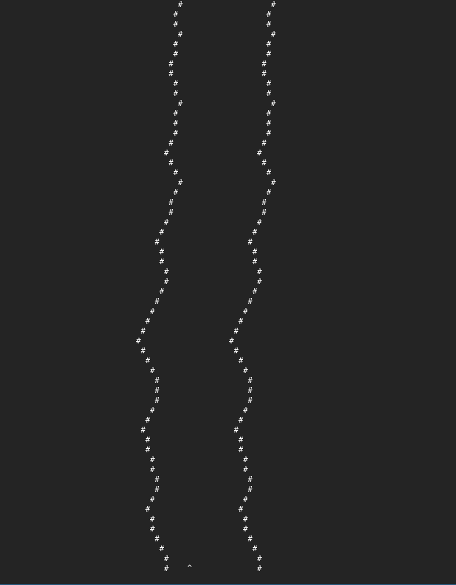

# TP9: Canyon infernal.

## Introduction.

Rapidly descend in an unpredictable and unforgiving canyon. All playable _only_ in the terminal.

The Canyon :


## Playing.

Use the keys :
- `h` : left ;
- `l` : right ;

**Goal**: stay in between the ravine and do not crash in the walls.

## Build.

Built on `ncurses`.

Development :
```sh
gcc main.c -o main -Wall -Wextra -Werror -pedantic -std=c11 -lncurses -fsanitize=address
./main
```

Release :
```sh
gcc main.c -o infernal-canyon-v1.0 -Wall -Wextra -Werror -pedantic -std=c11 -lncurses -O2
```
